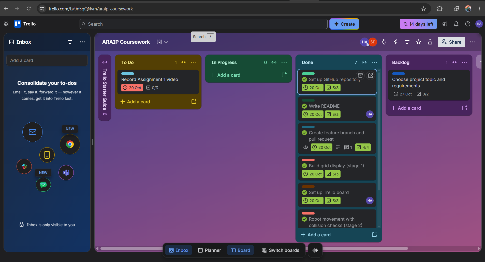
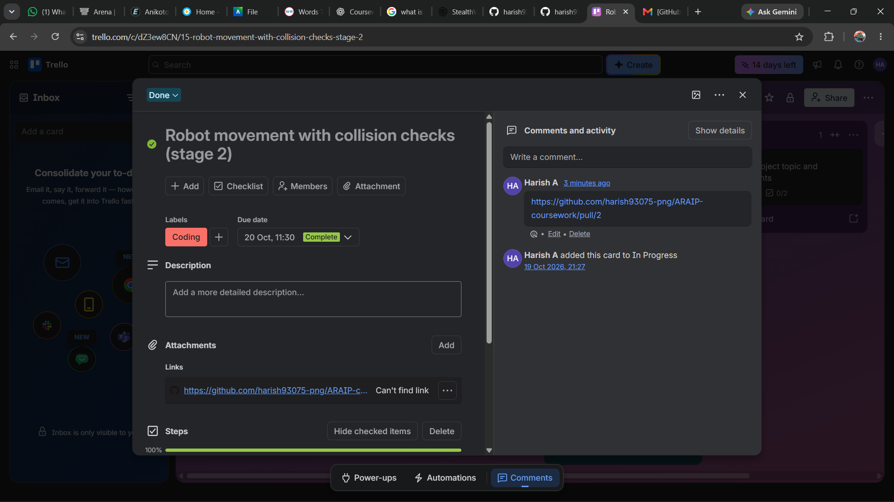
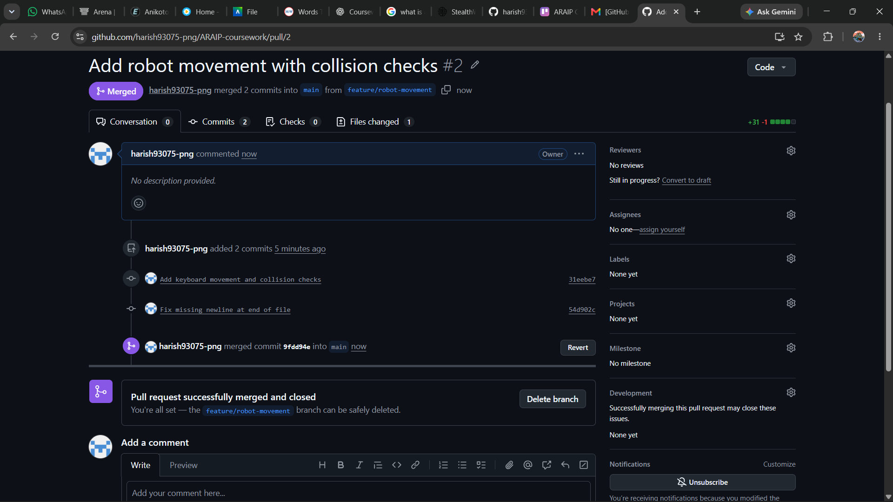
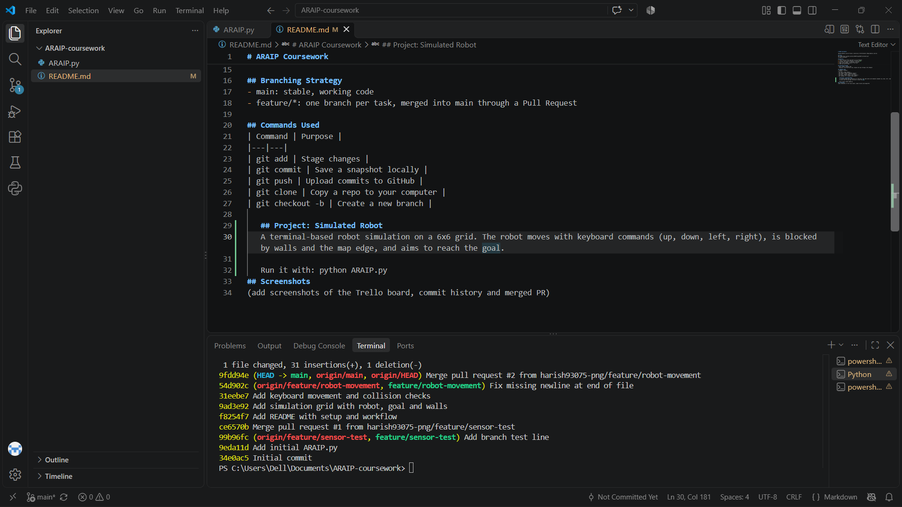
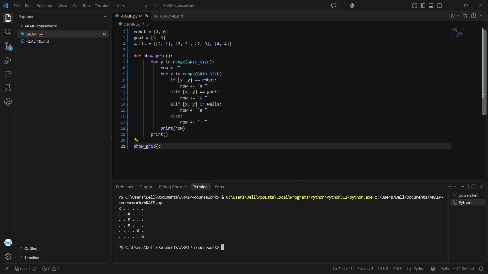

# ARAIP Coursework

Applied Robotics and AI Project, University of Hertfordshire (BEng Robotics and AI).

## Setup
git clone https://github.com/harish93075-png/ARAIP-coursework.git
cd ARAIP-coursework

## Workflow
1. Pick a card on Trello and move it to In Progress
2. Create a branch: git checkout -b feature/<name>
3. git add, git commit -m "message", git push
4. Open a Pull Request, merge it into main
5. Move the card to Done

## Branching Strategy
- main: stable, working code
- feature/*: one branch per task, merged into main through a Pull Request

## Commands Used
| Command | Purpose |
|---|---|
| git add | Stage changes |
| git commit | Save a snapshot locally |
| git push | Upload commits to GitHub |
| git clone | Copy a repo to your computer |
| git checkout -b | Create a new branch |

## Project: Simulated Robot
A terminal-based robot simulation on a 6x6 grid. The robot moves with keyboard commands (up, down, left, right), is blocked by walls and the map edge, and aims to reach the goal.

Run it with: python ARAIP.py

## Screenshots

### Trello board

### Trello card with PR link

### Merged pull request

### Git history

### Program running
